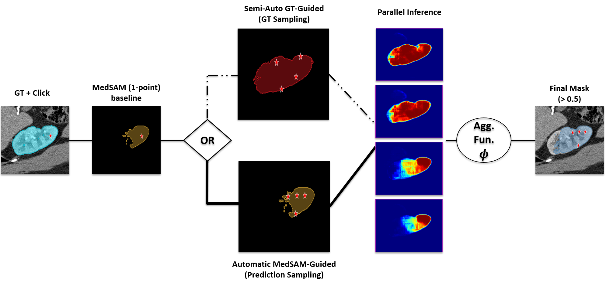

# Multiple Point MedSAM Prompting

Single-image demo for the paper:

> **Multiple Point MedSAM Prompting for Enhanced Medical Image Segmentation**
> Wasfieh Nazzal, Ezequiel López-Rubio, Miguel A. Molina-Cabello, Karl Thurnhofer-Hemsi
> *Computers, Materials & Continua*, 87(2), 92, 2026.
> DOI: [10.32604/cmc.2026.077561](https://doi.org/10.32604/cmc.2026.077561)



## Method

MedSAM is prompted with a single point. Instead of one point, this method samples
N points, runs MedSAM once per point, averages the probability maps, and thresholds
at 0.5. Two sampling strategies are compared against the single-point baseline:

- **Semi-Automatic GT-guided** — the N points are sampled from the ground-truth region.
- **Automatic** — the N points are sampled from the single-point baseline prediction.

Paper setting: N = 14, mean aggregation, threshold 0.5.

## Layout

```
medsam-multipoint/
├── README.md
├── requirements.txt
├── LICENSE
├── assets/
│   ├── demo_image.npy      # bundled demo slice (512×512)
│   ├── demo_gt.npy         # ground-truth label map
│   ├── demo_points.npz     # exact point prompts for reproducibility
│   └── method.png
└── src/
    └── demo.py
```

## Setup

```bash
pip install -r requirements.txt
pip install git+https://github.com/bowang-lab/MedSAM.git
```

Use a MedSAM ViT-B point-prompt checkpoint, placed at
`checkpoints/medsam_point_prompt_flare22.pth` (not redistributed here).

## Run

```bash
python src/demo.py \
    --image assets/demo_image.npy \
    --gt    assets/demo_gt.npy \
    --checkpoint checkpoints/medsam_point_prompt_flare22.pth \
    --n 14 --show semi \
    --output demo_result.png
```

The demo loads the exact prompts from `assets/demo_points.npz` (placed next to the
image), so the result is reproducible. It prints the DSC for all three arms and
writes `demo_result.png` (image, ground-truth outline, prediction fill, point
prompts). `--show` selects which arm is drawn (`baseline`, `semi`, or `auto`).
If `demo_points.npz` is absent, points are sampled at random from `--seed`.

Illustrative single slice — not dataset averages (see the paper for those):

| Arm | Points | DSC |
|---|---|---|
| Baseline (1 point) | 1 | 0.539 |
| Semi-Automatic GT-guided | 14 | 0.965 |
| Automatic | 14 | 0.967 |

The single-point baseline varies a lot from slice to slice, so one slice can sit
well below the dataset mean. This example is picked to show the effect clearly and
is not representative of the averaged results reported in the paper.

## Data

The bundled demo is a single abdominal CT slice from the FLARE22 dataset,
included only for illustration. Two `.npy` files (2D):

```
assets/demo_image.npy    # image (2D or H×W×3)
assets/demo_gt.npy       # ground-truth label map (2D), 0 = background
```

## Citation

```bibtex
@article{Nazzal2026,
  author  = {Wasfieh Nazzal and Ezequiel L{\'o}pez-Rubio and Miguel A. Molina-Cabello and Karl Thurnhofer-Hemsi},
  title   = {Multiple Point MedSAM Prompting for Enhanced Medical Image Segmentation},
  journal = {Computers, Materials \& Continua},
  year    = {2026},
  volume  = {87},
  number  = {2},
  pages   = {92},
  doi     = {10.32604/cmc.2026.077561},
  url     = {https://www.sciopen.com/article/10.32604/cmc.2026.077561}
}
```

## License

MIT (see LICENSE). Built on MedSAM (https://github.com/bowang-lab/MedSAM).
